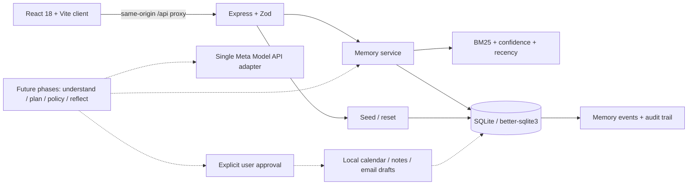

# LifeOS

**Your work, remembered.** A personal work agent that remembers how you work, plans with that context, asks before acting, and learns from your decisions.

**Remember → Plan → Ask → Act → Learn**

Built for the Meta Global AI Developer Hackathon · Indie track · “Build for Your World”.

> **Current milestone: Phase 1 — foundation.** The SQLite database, memory service, REST API, demo seed/reset, and a client status screen are implemented. Planning, model calls, approvals, tools, and reflection are scheduled for subsequent phases. See [the phase checklist](docs/PHASES.md).

<!-- Phase 6: insert a workspace screenshot and a GIF of the two-run learning demo here. -->

## Quick start

Prerequisites: **Node.js 20.19+** and **npm 10+**. The project targets Node 20; newer supported Node releases also work. Run these commands from the repository root:

```sh
npm install
npm run demo
```

Open **http://localhost:5173**. You should see the LifeOS foundation screen, a connected database, offline mock mode, and five demo memories. The API runs at **http://127.0.0.1:3001**. `npm run demo` seeds idempotently and starts both workspaces; Ctrl+C stops them.

No account, API key, or external database is needed. Inter is bundled locally; the client does not fetch a font from a third-party service.

For an empty first run, use `npm run dev` instead. Click **Load demo data** to add the five preferences. Repeated seeding preserves edits, archives, deletions, and confirmation counts.

### Commands

| Command                              | Purpose                                                                           |
| ------------------------------------ | --------------------------------------------------------------------------------- |
| `npm run dev`                        | Run the Vite client and Express server together                                   |
| `npm run seed`                       | Add missing demo memories to the configured SQLite file                           |
| `npm run demo`                       | Seed, then start both apps; respects `MOCK_MODE`                                  |
| `npm run test`                       | Run backend unit and HTTP integration tests in isolated databases                 |
| `npm run test:watch`                 | Re-run tests as files change                                                      |
| `npm run typecheck`                  | Check both strict TypeScript workspaces                                           |
| `npm run lint`                       | ESLint, with zero warnings allowed                                                |
| `npm run format:check`               | Check Prettier formatting                                                         |
| `npm run format`                     | Apply Prettier formatting                                                         |
| `npm run build`                      | Build the client and server, including the migration asset                        |
| `npm run check`                      | Typecheck, lint, formatting, tests, and builds                                    |
| `npm run start --workspace server`   | Start the compiled API after a build                                              |
| `npm run preview --workspace client` | Preview the static client build; an `/api` reverse proxy is needed for API access |

## Phase 1 features

- SQLite WAL storage with foreign keys, database constraints, transactional migrations, and checksums that detect changes to applied migrations.
- Typed memory CRUD, archives, reinforcement, contradictions, confidence decay, and persistent event history.
- BM25-style keyword retrieval weighted by confidence and recency, with small domain synonym groups and a human-readable explanation for each result.
- Same-key conflict handling: weaken conflicting values by **0.25**, create or strengthen the replacement, and retain before/after evidence for both sides.
- Confirmation increases confidence by **0.1**, capped at **0.98**. Confidence below **0.15** after weakening is auto-archived.
- Slow idle decay: a **30-day grace period**, then **−0.01 per full 30 unused days**. Maintenance runs at startup, daily, and before retrieval. Time decay does not count as a user contradiction.
- Idempotent seed data and an atomic full reset of all application tables.
- Strict Zod request validation, JSON-only mutations, a 32 KB body limit, Helmet, exact-origin CORS, and rate limiting.
- A responsive foundation screen with real health status, a memory preview, loading/error states, and one-click demo data.

## Architecture



Solid connections are implemented in Phase 1. Dashed connections describe the next milestones.

```text
client/             React + Vite + Tailwind foundation screen
server/src/db/      Complete schema, versioned migration runner, SQLite lifecycle
server/src/memory/  Schemas, retrieval ranking, transactional memory service
server/src/demo/    Stable seed identities and full reset
server/src/routes/  Health, memory, and demo HTTP endpoints
server/tests/       Memory, database, API, and configuration tests
docs/PHASES.md      Phase gates and acceptance commands
```

The full schema already contains `memories`, `memory_events`, `sessions`, `plans`, `plan_steps`, `calendar_events`, `notes`, `email_drafts`, `audit_log`, and `llm_calls`. Future-phase tables are empty until those features are implemented. `schema_migrations` tracks applied versions.

## Environment

Defaults work without an `.env` file. To customize them, copy `.env.example` to `.env` at the repository root. Server configuration and the Vite proxy both read it from there, regardless of the command's working directory.

| Variable                | Default                      | Description                                                                 |
| ----------------------- | ---------------------------- | --------------------------------------------------------------------------- |
| `NODE_ENV`              | `development`                | `development`, `test`, or `production`                                      |
| `HOST`                  | `127.0.0.1`                  | API listening address                                                       |
| `PORT`                  | `3001`                       | API port                                                                    |
| `CLIENT_ORIGIN`         | `http://localhost:5173`      | Exact permitted browser origin, without a trailing slash                    |
| `DATABASE_PATH`         | `server/data/lifeos.db`      | SQLite path, relative to the repo root; `:memory:` is available for tests   |
| `RATE_LIMIT_MAX`        | `120`                        | Requests per IP per 60 seconds                                              |
| `MOCK_MODE`             | `true`                       | Offline model mode; reported by health in Phase 1                           |
| `MODEL_BASE_URL`        | `https://api.example.com/v1` | Placeholder for the Meta-compatible base URL; integration begins in Phase 2 |
| `MODEL_API_KEY`         | empty                        | Server-only model credential; never a `VITE_*` variable                     |
| `MODEL_NAME`            | `meta-model-configure-me`    | Configure the model identifier after checking Meta's docs                   |
| `VITE_PORT`             | `5173`                       | Client development server port                                              |
| `VITE_API_PROXY_TARGET` | `http://127.0.0.1:3001`      | Server target for the client dev proxy                                      |

If you change a port, update the corresponding origin/proxy variable. `.env`, database files, and build artifacts are ignored by Git. The API does not return the model key or filesystem path.

## Phase 1 API

Responses and errors are JSON. Errors use `{ "error": { "code": "...", "message": "..." } }`. Mutation payloads are strict: unknown fields are rejected.

| Method | Endpoint                    | Request / behavior                                                                            |
| ------ | --------------------------- | --------------------------------------------------------------------------------------------- |
| GET    | `/api/health`               | Reports database connectivity, mock mode, configured model, and milestone                     |
| GET    | `/api/memories`             | Optional `type`, `source`, `search`, `include_archived=true`, `limit` (1–200), `offset`       |
| GET    | `/api/memories/:id`         | One memory                                                                                    |
| POST   | `/api/memories`             | `{type,key,value,rationale?,confidence?,source?}`; defaults to user source and 0.8 confidence |
| PATCH  | `/api/memories/:id`         | Any nonempty subset of memory fields, plus `archived`; set `archived:false` to restore        |
| DELETE | `/api/memories/:id`         | Deletes the memory and retains historical events                                              |
| GET    | `/api/memories/:id/history` | Most recent events first; `limit` and `offset` supported                                      |
| POST   | `/api/memories/retrieve`    | `{query,k?}`; returns scores/explanations and records use                                     |
| POST   | `/api/demo/seed`            | Empty body or `{}`; returns inserted/skipped/active counts                                    |
| POST   | `/api/demo/reset`           | `{ "confirm": "FORGET EVERYTHING" }`; clears every application table                          |

`POST /api/memories` creates a new memory. Exact active duplicates return 409. The internal `upsertMemory` and `resolveConflict` methods are the evidence-merging paths for future reflection; they preserve both sides of contradictions.

### Verify from PowerShell

With `npm run dev` or `npm run demo` running in another terminal:

```powershell
Invoke-RestMethod http://127.0.0.1:3001/api/health
Invoke-RestMethod -Method Post -Uri http://127.0.0.1:3001/api/demo/seed -ContentType 'application/json' -Body '{}'
(Invoke-RestMethod http://127.0.0.1:3001/api/memories).memories | Format-Table key, confidence, source
Invoke-RestMethod -Method Post -Uri http://127.0.0.1:3001/api/memories/retrieve -ContentType 'application/json' -Body '{"query":"Prepare for my Friday investor call.","k":3}'
```

Expect `status: ok`, `mockMode: true`, five active demo memories, and retrieved results containing scores and `why_retrieved` explanations. Reseeding returns `inserted: 0` and `skipped: 5`.

To deliberately clear the local demo database, including histories and audit records:

```powershell
Invoke-RestMethod -Method Post -Uri http://127.0.0.1:3001/api/demo/reset -ContentType 'application/json' -Body '{"confirm":"FORGET EVERYTHING"}'
```

## Testing and persistence

The backend suite covers relevance ranking, recency/confidence weighting, synonym retrieval, conflicts, the archive threshold, confirmations, idle decay, atomic event recording, migration integrity, persistence, complete reset, seeding, validation, CORS, rate limiting, and body limits. Tests use independent in-memory databases plus one disposable disk database; they do not touch your configured application database.

Migrations run automatically on boot and in the seed command. Treat applied migrations as immutable; add a new numbered migration for future changes. Writes and their memory/audit evidence share a transaction. WAL is checkpointed on graceful shutdown.

## What's real vs. mocked

**Real now:** SQLite persistence, memory retrieval and mutations, event/audit recording, seed/reset, health checks, and the client-to-server connection. Phase 1 makes **zero LLM calls**, even if `MOCK_MODE=false`.

**Planned model integration:** one adapter in `server/src/llm/client.ts` will call Meta's models for goal/entity extraction, memory-aware planning, and post-review reflection that extracts new memories and identifies contradictions. Zod will validate each output; deterministic code will enforce policy and update confidence. Offline mock responses will exercise the same loop.

**Local simulations by design, implemented in Phase 4:** email becomes a stored draft and is never sent; calendar blocks and notes stay in SQLite. There are no OAuth integrations or external tool actions.

## Planned two-run demo

The seed contains: no meetings before 11am; short bullet-style emails; protected Friday afternoons; 25-minute prep blocks; Thursday investor updates.

1. Ask: “Prepare for my Friday investor call.”
2. Review a 9:00 AM prep proposal with an explicit preference conflict warning; reject it as “too early”. Edit the email.
3. Reflect and show learned morning-block and email-style preferences with before/after evidence.
4. Ask: “Get ready for next week's board meeting.”
5. Compare the runs: the new plan avoids mornings and cites the newly learned style.

This scenario becomes executable in Phases 2–5. The seeded 11am rule must not be silently bypassed to stage the 9am proposal: the policy checker will visibly flag it, and “approve all safe steps” must exclude it.

## Privacy and control

LifeOS is a **local, single-user app**. The API binds to loopback by default. Authentication and multi-user hosting are outside this milestone; CORS and rate limiting are not substitutes for authentication.

- Memories and their evidence live in one local SQLite database. The WAL/SHM sidecars are SQLite's normal operating files.
- Deleting a memory removes it from retrieval. Its historical snapshots remain in memory events and the audit trail so changes can be explained. Full reset clears that history too.
- Full reset is a logical database deletion, not a forensic secure erase of filesystem blocks or backups.
- Phase 1 sends no data to a model. In future live-model mode, relevant context will be sent to the configured model endpoint.
- Export and in-app forget controls arrive in Phase 7; the confirmed reset API is available now.

## Roadmap

Complete the approval-gated learning loop, then add real Gmail/Calendar OAuth, optional hybrid embedding retrieval, and open-weights self-hosting for private memory. The phase gates keep the demoable core ahead of breadth.
