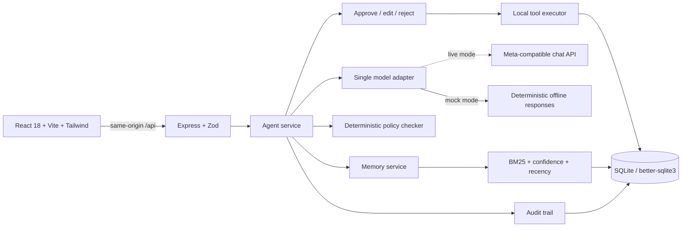

# LifeOS

**Your work, remembered.** A personal work agent that learns how you work, plans with that context, asks before acting, and gets measurably better after each decision.

**Remember → Plan → Ask → Act → Learn**

Built for the Meta Global AI Developer Hackathon · Indie track · “Build for Your World”.

```sh
npm install
npm run demo
```

Open **http://localhost:5173**. No account, API key, or external service is required. The API runs at **http://127.0.0.1:3001**. `npm run demo` seeds five fictional preferences and starts both workspaces; Ctrl+C stops them.

## Why it is different

Most assistants either forget you or act without asking. LifeOS closes the loop:

1. **Remember** — a local memory store with confidence, evidence, and history.
2. **Plan** — the model proposes tool steps and cites the memories behind them.
3. **Ask** — every step waits for approve, edit, or reject-with-reason. A deterministic policy checker can block unsafe approvals.
4. **Act** — approved actions write local calendar blocks, notes, and email drafts. Nothing leaves the device.
5. **Learn** — reflection turns your reviews into new preferences, confidence changes, and a visibly different next plan.

The two-minute demo shows all five stages, including a preference that changes a later schedule.

## Demo script

Seed data: no meetings before 11:00, short bullet emails, protected Friday afternoons, 25-minute prep blocks, Thursday investor updates. All times are UTC.

1. Click **Start guided demo**. The goal is “Prepare for my Friday investor call.”
2. The plan includes a 09:00 prep block. It is intentionally staged and visibly blocked by the 11:00 preference.
3. Reject the block with “too early”. Edit the agenda email and keep your own structure.
4. Click **Learn from this**. Review new inferred memories, reinforced items, and confidence changes.
5. Click the offered next goal, “Get ready for next week's board meeting.”
6. Compare v1 and v2: the new plan starts at noon and cites your edited email style. Approve safe steps and run them.
7. Check Calendar, Drafts, Notes, and Audit. Everything is local and labeled simulated.

Shortcuts on the selected plan card: `A` approve, `E` edit, `R` reject. The **Model activity** drawer shows every model call, including mock calls.

## Architecture



```text
client/src/            React app, Zustand store, onboarding, drawers, plan workspace
client/src/components/ Plan cards, memory panel, library views, drawers, data controls
server/src/agent/      Understanding, planning, review, execution, reflection
server/src/llm/        Adapter, prompts, deterministic mock implementation
server/src/memory/     Schemas, retrieval ranking, memory lifecycle
server/src/tools/      Tool schemas, validation, local execution
server/src/db/         Immutable numbered migrations, schema, SQLite lifecycle
server/src/routes/     REST endpoints
server/tests/          Memory, database, API, LLM, planning, execution, learning tests
docs/                  Phase gates, decisions, architecture, prompt documentation
```

The database holds `memories`, `memory_events`, `memory_embeddings`, `sessions`, `plans`, `plan_steps`, `calendar_events`, `notes`, `email_drafts`, `audit_log`, and `llm_calls`. Migrations are checksummed; applied files are never edited.

## What is real vs. simulated

**Real:** SQLite persistence, migrations, memory lifecycle and retrieval, model adapter with repair retries, schema-validated planning, deterministic policy enforcement, approval workflow, local tool execution, reflection and memory updates, audit trail, export, reset, mock model. Retrieval can optionally blend cached embedding similarity; keyword ranking remains the default and the fallback.

**Simulated by design:** email is a stored draft and is never sent; calendar blocks and notes stay in SQLite. There is no Gmail/Calendar OAuth, no external contact lookup, and no background agent. Every tool result is labeled `simulated: true`.

**Live model mode:** set `MOCK_MODE=false`, then configure `MODEL_BASE_URL`, `MODEL_API_KEY`, `MODEL_NAME`, and—if the provider differs—`MODEL_AUTH_HEADER`, `MODEL_AUTH_PREFIX`, and `MODEL_JSON_MODE`. The single adaptation point is `mapProviderProtocol` in `server/src/llm/client.ts`. Confirm the exact Meta model identifier in Meta's documentation before recording a demo. In live mode, relevant prompts and memory context go to that endpoint; keys stay server-side. If a live call fails, `MOCK_FALLBACK=true` opts into clearly labeled offline fallback; the default is an honest error after three attempts. `EMBEDDINGS_ENABLED=true` additionally sends the goal and memory key/value text to `/embeddings`; leave it off for a fully offline run.

## API

Errors use `{ "error": { "code": "...", "message": "..." } }`. Mutations are strict JSON; unknown fields are rejected.

| Method | Endpoint                    | Purpose                                                 |
| ------ | --------------------------- | ------------------------------------------------------- |
| GET    | `/api/health`               | Database, model mode, configured model, current phase   |
| GET    | `/api/memories`             | Filter, search, paginate; `include_archived=true`       |
| POST   | `/api/memories`             | Create a user memory                                    |
| PATCH  | `/api/memories/:id`         | Edit value/confidence or archive/restore                |
| DELETE | `/api/memories/:id`         | Delete while keeping historical evidence                |
| GET    | `/api/memories/:id/history` | Confidence and evidence timeline                        |
| POST   | `/api/memories/retrieve`    | Ranked memories with scores and explanations            |
| POST   | `/api/sessions`             | `{goal,demo?}`; understand, retrieve, plan              |
| GET    | `/api/sessions`             | Recent sessions                                         |
| GET    | `/api/sessions/:id`         | Session, active plan, review context, learned result    |
| POST   | `/api/steps/:id/approve`    | Approve; blocking policy returns 409                    |
| POST   | `/api/steps/:id/edit`       | Save validated args and mark edited                     |
| POST   | `/api/steps/:id/reject`     | `{reason}`; records evidence                            |
| POST   | `/api/sessions/:id/execute` | Run approved local tools in a per-step transaction      |
| POST   | `/api/sessions/:id/reflect` | Explicit learning; locks the session                    |
| GET    | `/api/calendar`             | Local calendar blocks linked to steps and sessions      |
| GET    | `/api/notes`                | Approved local notes                                    |
| GET    | `/api/drafts`               | Email drafts, never sent                                |
| GET    | `/api/audit`                | Complete action trail                                   |
| GET    | `/api/llm-calls`            | Latest 100 model calls with latency and token metadata  |
| GET    | `/api/export`               | Download every table as JSON                            |
| POST   | `/api/demo/seed`            | Idempotent fictional context                            |
| POST   | `/api/demo/reset`           | `{ "confirm": "FORGET EVERYTHING" }`; clears all tables |

## Environment

Copy `.env.example` to `.env`. Defaults work offline.

| Variable                                      | Default                        | Description                                        |
| --------------------------------------------- | ------------------------------ | -------------------------------------------------- |
| `NODE_ENV`                                    | `development`                  | `development`, `test`, or `production`             |
| `HOST` / `PORT`                               | `127.0.0.1` / `3001`           | API binding                                        |
| `CLIENT_ORIGIN`                               | `http://localhost:5173`        | Exact CORS origin, no trailing slash               |
| `DATABASE_PATH`                               | `server/data/lifeos.db`        | Relative to repo root; `:memory:` for tests        |
| `RATE_LIMIT_MAX`                              | `120`                          | Requests per IP per minute                         |
| `MOCK_MODE`                                   | `true`                         | Offline deterministic model                        |
| `MODEL_BASE_URL`                              | `https://api.example.com/v1`   | OpenAI-compatible chat-completions base URL        |
| `MODEL_API_KEY`                               | empty                          | Server-only credential; never a `VITE_*` value     |
| `MODEL_NAME`                                  | `meta-model-configure-me`      | Exact provider model identifier                    |
| `MODEL_AUTH_HEADER` / `MODEL_AUTH_PREFIX`     | `Authorization` / `Bearer`     | Provider auth shape                                |
| `MODEL_JSON_MODE`                             | `true`                         | Request JSON object mode                           |
| `MODEL_TIMEOUT_MS`                            | `8000`                         | Per-attempt timeout                                |
| `MOCK_FALLBACK`                               | `false`                        | Opt in to labeled offline fallback                 |
| `EMBEDDINGS_ENABLED`                          | `false`                        | Optional semantic reranking; keyword-only when off |
| `EMBEDDINGS_BASE_URL` / `EMBEDDINGS_API_KEY`  | model values                   | OpenAI-compatible `/embeddings` endpoint           |
| `EMBEDDINGS_MODEL`                            | `embedding-model-configure-me` | Exact embedding model identifier                   |
| `EMBEDDINGS_TIMEOUT_MS` / `EMBEDDINGS_WEIGHT` | `8000` / `0.35`                | Per-attempt timeout and semantic blend weight      |
| `VITE_PORT` / `VITE_API_PROXY_TARGET`         | `5173` / `127.0.0.1:3001`      | Dev server and API proxy                           |

## Privacy and control

- Single-user, local-first app. The API binds to loopback. Authentication and multi-user hosting are intentionally out of scope; CORS and rate limiting do not replace auth.
- Memories, plans, drafts, notes, calendar blocks, and audit entries live in one SQLite file.
- **Export JSON** downloads every table. **Forget everything** requires typing `FORGET EVERYTHING` and then clears all application tables, including history.
- Deletion is a logical SQLite operation, not a forensic wipe of filesystem blocks or backups.
- In mock mode, no data leaves the machine. In live mode, goal text, retrieved memories, and review evidence are sent to the configured model endpoint.
- Model keys are read server-side only and never returned by the API.

## Testing and quality gates

```sh
npm run check
```

Runs strict TypeScript, ESLint with zero warnings, Prettier check, 58 backend tests, and both production builds. Tests cover memory math, migrations, validation, CORS, rate limits, planning, policy conflicts, review/execute flows, library links, and the full learning loop in isolated databases.

```sh
npm run seed        # add missing demo memories
npm run test:watch  # backend watch mode
npm run build       # client and compiled server
npm run format      # apply Prettier
```

## Limitations and next steps

- Email and calendar tools are deliberately local simulations, not OAuth integrations.
- Retrieval is BM25-style keyword ranking with confidence and recency. Optional embedding reranking is cached and default-off; if the endpoint fails, planning silently returns to keyword results, so semantic quality is not guaranteed in every live setup.
- Reflection is explicit, not a background learner. One reflected session can seed the next plan, but there is no long-running daemon.
- No streaming; planning shows a staged progress state instead.
- Live-model prompts are provider-generic. Exact Meta model behavior should be validated end to end before a submission recording.
- Future: Gmail/Calendar connectors, on-device embeddings, multi-session learning summaries, and encrypted backups.

See [phase gates](docs/PHASES.md), [design decisions](docs/DECISIONS.md), [architecture](docs/ARCHITECTURE.md), and [prompt contracts](docs/PROMPTS.md).
