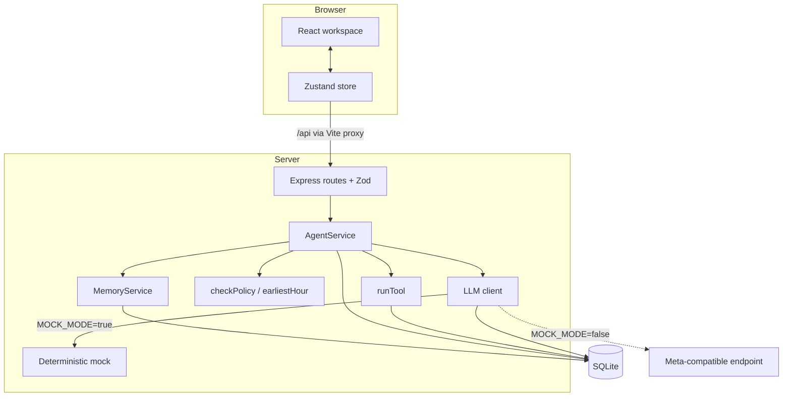

# Architecture

LifeOS is one local process group: a Vite/React client, an Express API, and a single SQLite file. Model output is advisory. Deterministic TypeScript owns validation, policy, approval, execution, and memory math.

## Runtime shape

Trust boundaries: the browser never sees credentials or prompts. The API binds to loopback by default and restrictively allows one origin. SQLite is the source of truth. The model endpoint is the only outbound boundary, and only in live mode.

## Request lifecycle

### 1. Plan

`POST /api/sessions` runs `AgentService.createSession`:

1. Persist a session with `goal_text`, `demo_scenario`, and status `planning`.
2. `understand()` calls the model with `UNDERSTAND_PROMPT`, validates the response, and falls back to deterministic extraction if needed.
3. Retrieve memories through BM25-style ranking, confidence, and recency.
4. `plan()` sends the goal, retrieved context, policy summary, and tool contracts with `PLAN_PROMPT`.
5. Validate with Zod: maximum 8 steps, known tools, schema-valid args, cited memory IDs restricted to supplied context.
6. Run `checkPolicy` on every calendar step and persist blocking/non-blocking warnings.
7. Insert the plan, steps, retrieval evidence, and audit entries in a transaction. Status becomes `awaiting_review`.

The demo fixture injects a labeled 09:00 investor prep block only when `demo: true`. It is a plan fixture, not a memory override.

### 2. Review

- Approve: blocked steps return 409 `POLICY_CONFLICT`; otherwise status becomes `approved`.
- Edit: args are validated against the same tool schema. The edit is also checked for policy. Safe repairs clear blocking warnings and mark `{repaired:true, blocking:false}`. Unsafe edits remain blocked. Saving an edit records `edited`.
- Reject: a reason of at least three characters is required. The step becomes `rejected` and the reason is stored as evidence.
- Each review writes an audit entry. The step's cited memories are shown in the UI.

### 3. Execute

`POST /api/sessions/:id/execute`:

1. Reject reflected/locked sessions and empty runnable sets.
2. Load only `approved` or `edited` steps.
3. For each step, re-check policy against current memories in case context changed after approval.
4. Run the narrow tool implementation inside a per-step transaction and store a result.
5. Continue after individual failures; the session summary reports attempted/succeeded/failed.
6. Write `session.execute`, `step.executed`/`step.failed`, and `session.executed` audit entries. Status becomes `completed`.

`create_calendar_block` additionally checks overlaps against existing local events and returns a named conflict. Nothing is rolled back across steps: each local action stands on its own, and the audit trail reflects exactly what happened.

### 4. Reflect

Reflection is explicit and one-time:

1. Requires at least one reviewed step, then sets status `reflected` to freeze evidence.
2. Sends reviewed steps (approvals, before/after edits, rejection reasons) with `REFLECT_PROMPT`.
3. Validates structurally, then semantically: evidence IDs must be reviewed steps in this session; every memory ID must exist in the supplied context; confidence is capped at 0.98; source is `inferred`.
4. Upserts new preferences, weakens same-key conflicts through the memory service, applies reinforcement/weakening, records memory events and `session.reflected`, and stores `learned_json`.
5. The client renders the learned diff, and the next plan retrieves the updated memories.

## Memory model

- Active memories only participate below the archive threshold. Confidence is mapped to a 0–1 float.
- Reinforcement: `+0.1`, capped at `0.98`.
- Contradiction: `−0.25`, then auto-archive below `0.15`.
- Idle decay: 30-day grace, then `−0.01` per full 30 unused days, applied at startup, daily, and before retrieval.
- Same-key conflicts preserve before/after values in `memory_events`. Unrelated preferences are never weakened.
- Retrieval is keyword-only: tokenized BM25-style scoring, small domain synonyms, confidence and recency weighting, plus a human-readable explanation stored with each proposal.

## Policy engine

Deterministic and independent of the model:

- Active preference memories with confidence ≥ 0.7 influence calendar checks.
- Parses earliest-start language (including “noon”) and broad “avoid mornings” rules, which map to 12:00 UTC.
- Blocks prep blocks longer than a stored prep duration.
- Blocks blocks crossing a protected Friday afternoon.
- Blocks approvals and re-checks at execution time.
- Calendar overlap is enforced by the tool executor with the existing event named.

## Data and migrations

`schema_migrations` stores version, name, checksum, and application time. Applied files are immutable; changes require a new numbered migration. Writes and their memory/audit evidence share transactions. WAL is checkpointed on graceful shutdown. `PRAGMA foreign_keys` is enabled.

Tables: `memories`, `memory_events`, `sessions`, `plans`, `plan_steps`, `calendar_events`, `notes`, `email_drafts`, `audit_log`, `llm_calls`.

## Model adapter

- One OpenAI-compatible chat-completions path, with the provider mapping isolated in `mapProviderProtocol`.
- Three attempts with exponential backoff; two schema-repair retries; code-fence stripping; 32 KB request body discipline; 8-second default timeout.
- Every call is recorded with purpose, model, latency, token usage when supplied, retries, mode, and error code. Prompts are not stored in the activity drawer or export.
- `MOCK_MODE=true` uses deterministic responses that implement the same contracts, including reflection.
- Live failures are honest errors unless `MOCK_FALLBACK=true`, in which case the result is labeled fallback.

## Client

- Zustand holds health, memories, sessions, active detail, pending step IDs, and busy flags. Server state is re-fetched after mutations; optimistic step patches keep review feedback immediate.
- The workspace is one loop: goal input, conversation context, plan cards, execution bar, learned card, and plan comparison.
- Onboarding, model activity, demo script, and forget confirmation are dialogs with initial focus and Escape close.
- Reduced motion is respected globally. Framer Motion is limited to occasional arrivals and state transitions.

## Failure handling

- Malformed model output is repaired twice, then rejected; the server returns a typed error rather than persisting partial plans.
- Review and execution are idempotent with respect to status checks; duplicate runs return `NOTHING_TO_RUN`.
- Reflected sessions cannot execute or reflect again.
- Client mutations surface toast errors with retry where safe.
- The app never silently falls back to mock output in live mode.

## Known constraints

- Single user, no authentication; do not expose the API to untrusted networks.
- Simulated tools only; no OAuth or external side effects.
- Keyword retrieval is intentional and dependency-free.
- Times are UTC end to end; user timezone is never inferred.
- The learning loop is session-scoped, not a background daemon.
